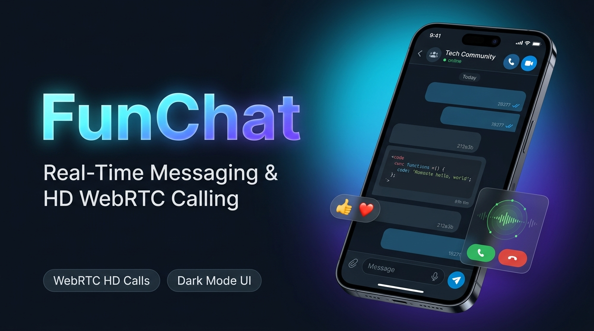

<p align="center">
  
</p>

# FunChat - Setup & Deployment Guide

A fast, real-time messaging and HD voice/video calling web application built with React, Vite, WebRTC, and Firebase Realtime Database.

---

## 📋 Prerequisites
- A free **[Firebase Account](https://console.firebase.google.com/)**
- A free **[Vercel Account](https://vercel.com/)**
- A **[GitHub](https://github.com/)** account (to push your repository)

---

## 🚀 Step 1: Set Up Firebase

1. Open the [Firebase Console](https://console.firebase.google.com/) and click **"Add project"**.
2. Give your project a name (e.g., `my-funchat`) and complete the creation steps.

### A. Enable Google Authentication
1. In your Firebase project sidebar, click **Build** > **Authentication**.
2. Click **"Get Started"**, then select **"Google"** under Sign-in providers.
3. Toggle **Enable**, choose your support email, and click **Save**.

### B. Create Realtime Database
1. In the sidebar, click **Build** > **Realtime Database**.
2. Click **"Create Database"**, choose a region closest to you, and choose **"Start in locked mode"**.
3. Go to the **Rules** tab, replace the entire editor content with the following security rules, and click **Publish**:

```json
{
  "rules": {
    "users": {
      ".read": "auth != null",
      ".write": "auth != null",
      ".indexOn": ["username"]
    },
    "groups": {
      ".read": "auth != null",
      ".write": "auth != null",
      ".indexOn": ["username"]
    },
    "groupMessages": {
      ".read": "auth != null",
      ".write": "auth != null",
      "$groupId": {
        ".indexOn": ["timestamp"]
      }
    },
    "personalChats": {
      ".read": "auth != null",
      ".write": "auth != null",
      "$chatId": {
        "messages": {
          ".indexOn": ["timestamp"]
        }
      }
    },
    "globalMessages": {
      ".read": "auth != null",
      ".write": "auth != null",
      ".indexOn": ["timestamp"]
    },
    "userChats": {
      ".read": "auth != null",
      ".write": "auth != null",
      "$uid": {
        ".indexOn": ["lastMessage/timestamp"]
      }
    },
    "systemConfig": {
      ".read": true,
      ".write": "auth != null"
    },
    "signaling": {
      ".read": "auth != null",
      ".write": "auth != null"
    }
  }
}
```

### C. Get Your Firebase Web Credentials
1. Click the **Gear icon (⚙️)** next to "Project Overview" > **Project settings**.
2. Scroll down to **"Your apps"**, click the **Web icon (`</>`)**, and register your app (e.g., `funchat-web`).
3. You will see a `firebaseConfig` object with keys like `apiKey`, `authDomain`, `databaseURL`, `projectId`, etc. Keep this tab open.

---

## ⚙️ Step 2: Configure Your Credentials

All credentials and endpoints are centralized in **one single file**: `src/config.ts`. You do **not** need to edit multiple files!

You have two easy ways to set your credentials:

### Option A: Edit `src/config.ts` Directly (Easiest)
Open `src/config.ts` and replace the placeholder strings with your actual Firebase values:

```typescript
export const firebaseConfig = {
  apiKey: "AIzaSy...",                                                // Replace with your Firebase apiKey
  authDomain: "your-project-id.firebaseapp.com",                      // Replace with your authDomain
  databaseURL: "https://your-project-id-default-rtdb.firebaseio.com", // Replace with your databaseURL
  projectId: "your-project-id",                                       // Replace with your projectId
  storageBucket: "your-project-id.firebasestorage.app",               // Replace with your storageBucket
  messagingSenderId: "123456789012",                                  // Replace with your messagingSenderId
  appId: "1:123456789012:web:abcdef123456",                          // Replace with your appId
};
```

*(Note: The app base URL and invite links automatically adapt to whatever domain you deploy on, so you don't have to change them!)*

---

### Option B: Use Vercel Environment Variables
If you prefer not to hardcode credentials in source code, leave `src/config.ts` as is and enter these environment variables in your Vercel Dashboard (see Step 3 below):

- `VITE_FIREBASE_API_KEY`
- `VITE_FIREBASE_AUTH_DOMAIN`
- `VITE_FIREBASE_DATABASE_URL`
- `VITE_FIREBASE_PROJECT_ID`
- `VITE_FIREBASE_STORAGE_BUCKET`
- `VITE_FIREBASE_MESSAGING_SENDER_ID`
- `VITE_FIREBASE_APP_ID`

---

## 🌐 Step 3: Deploy to Vercel (Using Vercel Website)

You can deploy directly through the **Vercel Website Dashboard** without using any terminal commands:

1. Push this project to your **GitHub** account as a new repository.
2. Go to **[vercel.com](https://vercel.com/)** and log in.
3. On your Vercel Dashboard, click **"Add New..."** in the top right, then select **"Project"**.
4. Find your repository in the list and click **"Import"**.
5. In the configuration screen:
   - **Framework Preset**: It will automatically detect **Vite**.
   - **Root Directory**: Leave as `./` (default).
   - **Build Command**: `npm run build` (default).
   - **Output Directory**: `dist` (default).
6. *(Optional)* If using **Option B** for credentials:
   - Click to expand the **"Environment Variables"** section.
   - Add each variable (`VITE_FIREBASE_API_KEY`, `VITE_FIREBASE_AUTH_DOMAIN`, etc.) and paste your values.
7. Click **"Deploy"**.
8. Wait ~1-2 minutes for the build to finish. Once done, Vercel will give you your live URL (e.g., `https://my-funchat.vercel.app`).

---

## ⚠️ Step 4: Authorize Your Vercel Domain in Firebase (CRITICAL)

Google Sign-In will **not** work until you add your Vercel domain to Firebase Authorized Domains!

1. Go back to your [Firebase Console](https://console.firebase.google.com/).
2. In the sidebar, click **Build** > **Authentication**.
3. Click the **Settings** tab at the top.
4. Click **"Authorized domains"** in the left submenu.
5. Click **"Add domain"**.
6. Enter your Vercel domain **without** `https://` (e.g. `my-funchat.vercel.app`) and click **Add**.

🎉 **You are all done!** Open your Vercel URL and sign in with Google to start chatting!

---

## 💻 Optional: Running Locally

If you want to run the project on your computer:

1. Install dependencies:
   ```bash
   npm install
   ```
2. Start the local development server:
   ```bash
   npm run dev
   ```
3. Open `https://localhost:5173` in your browser.
*(Note: An SSL certificate is automatically generated so camera and microphone permissions work locally for WebRTC calling).*
